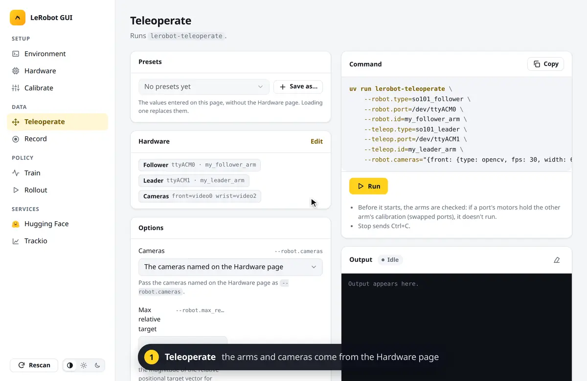

# lerobot-gui

[](https://github.com/hachimada/lerobot-gui/actions/workflows/ci.yml)
[](LICENSE)
[](https://github.com/huggingface/lerobot)
[](https://www.python.org/)

A local web GUI for [LeRobot](https://github.com/huggingface/lerobot). Each task has a page that
builds its `lerobot-*` command from a form, so there is no long command to write by hand and no
option list to memorize; it shows the exact command line, runs it with live output, and saves a
page's values as a preset to run again. The options, defaults and choices are read from the
installed lerobot, not copied into the GUI, so the forms agree with it; tests check that the
commands they build parse in lerobot.



It helps build the commands; it doesn't judge them. Only what you enter goes into the command, an
empty field shows lerobot's default and leaves it to lerobot, and whether lerobot accepts a
combination is for lerobot to say when it runs.

## Tested robots

| Robot | lerobot types |
|---|---|
| [SO-ARM101](https://huggingface.co/docs/lerobot/so101) follower and leader, with USB cameras | `so101_follower`, `so101_leader` |

For now the commands always use these types; choosing another robot is planned.

## Requirements

- Linux (macOS isn't tested yet; Windows isn't supported yet)
- Python 3.12+ with lerobot 0.7 or newer
- Node.js 20.19+ (22 LTS recommended) and npm, to build the frontend once
- [uv](https://docs.astral.sh/uv/) is recommended; pip works too

## Install

```bash
git clone https://github.com/hachimada/lerobot-gui.git
cd lerobot-gui/frontend
npm ci
npm run build
```

The GUI runs the `lerobot-*` commands of the environment it is installed in. There are three ways
to set that up:

| | When | How |
|---|---|---|
| **A** | lerobot isn't installed yet | `uv sync` in lerobot-gui (installs lerobot too) |
| **B** | lerobot is a dependency of a uv project | `uv add --editable /path/to/lerobot-gui` in that project |
| **C** | lerobot is in another virtualenv or conda environment | `pip install -e /path/to/lerobot-gui` in it |

The arms need the `dialout` group (`sudo usermod -aG dialout $USER`). Details:
[docs/install.md](docs/install.md).

## Start

```bash
cd /path/to/workspace      # the commands run here
lerobot-gui                # in A: /path/to/lerobot-gui/.venv/bin/lerobot-gui
```

It opens <http://127.0.0.1:7878/>. Then: [first steps](docs/usage.md#first-steps).

## Documentation

- [Install](docs/install.md): the three ways in detail, updating
- [Usage](docs/usage.md): first steps in the GUI, what goes into a command, using it from another
  computer
- [Configuration](docs/configuration.md): start options, environment variables, where things go
- [Troubleshooting](docs/troubleshooting.md)
- [Development](docs/development.md): how it is built, following lerobot, tests

## License

[Apache License 2.0](LICENSE). The third-party material it includes (React in the frontend build,
icons from Feather and Lucide) and their licenses: [THIRD_PARTY_NOTICES.md](THIRD_PARTY_NOTICES.md).
